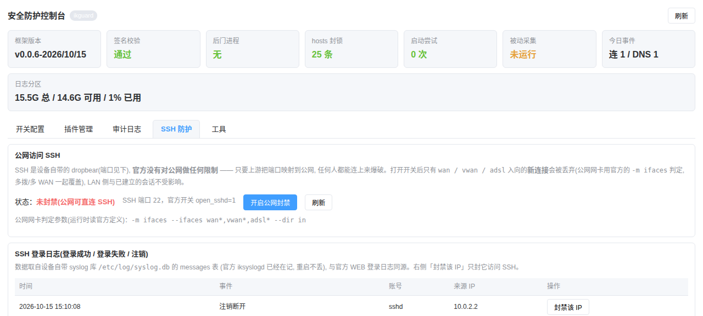
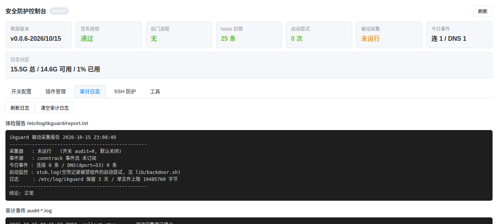

# iKuai 插件框架 (ikuai-plugins)

走官方**插件通道**（`firmwareid=90001`）给 iKuai 装上一个基础包，设备随即获得
**后门/更新通道阻断、插件系统、SSH 加固、审计取证、Web 控制台**。
不刷固件、不改分区表，卸载即恢复（基础包 = 一个签名的 `.bin` + 一个 `install.sh`）。

## 当前支持的功能

| 功能 | 开关 | 默认 | 说明 |
| --- | --- | --- | --- |
| **后门/更新通道阻断** | `backdoor` | 开 | ① 5 个云端客户端（`ik_rc_client`/`cre`/`pmd`/`dtalkd`/`dtalkc`）换成**空壳**；② 改写启动点：`rc`、`utils/monitor_process.sh`、`upgrade.sh`、`utils/collection.sh`、`dingtalk.sh`、`catcherd.sh`、`utils/submit.lua`、`utils/update_hosts.sh`、`ikaudit_update.sh`；③ 25 个云端域名写进 `/etc/hosts.d/ikblock` 片段指向 `0.0.0.0`；④ 空壳/被禁脚本被**任何**代码路径拉起时，往 `/etc/log/ikguard/stub.log` 记一行（时间 + 拉起者），据此发现枚举遗漏的新启动点。每次开机重应用 |
| **SSH 加固** | `sshguard` | 关 | ① 封禁 **WAN 侧新 SSH 连接**（公网网卡用官方 `-m ifaces` 判定、端口读官方 `sshd_port`、只拦 `--ctstate NEW` 所以不影响已建立的会话）；② **一键封禁来源 IP**（持久名单、开机重放，只挡它访问 SSH 端口，Web 不受影响）；③ Web 里看 **SSH 登录/失败/注销日志**（读官方 `/etc/log/syslog.db`，不另采）。命令行 `bin/sshguard` |
| **插件系统** | `plugins` | 开 | Web「高级应用 → 插件管理」出现卡片（**无需绑定爱快云**）；上传 zip 即安装；插件可放数据盘（存储位置绑定）；CLI `bin/ikplugin`（install/remove/scan/verify/pack/keygen） |
| **SSH 登录** | `sshd` | 开 | 把 `sshd` 账号的 shell 从控制台菜单换成 `/bin/bash`，可用 SSH 直接映射文件、改配置 |
| **审计取证** | `audit` | 关 | 常驻**被动采集**：conntrack 连接事件 / DNS 查询 / 封锁命中，日志落 `/etc/log/ikguard`。不占 cron |
| **cron / shell** | `cron` `shell` | 开 | `/etc/mnt/cron.d/*` → `/etc/crontabs/cron.d`；`/etc/mnt/shells` 下的程序与配置链接进系统 |
| **网页控制台** | 随 `plugins` | — | 状态概览（版本/验签/后门进程/hosts 条数/启动尝试/采集/日志分区）+ 开关配置 + 插件管理 + 审计日志 + **SSH 防护** + 工具（封锁自检、磁盘信息、原生日志与 DNS 开关） |
| **/etc/mnt 扩容** | — | — | `bin/ikexpand`：官方升级包只给 50M，可按 G 扩容且保住数据盘、跨重启有效、可回滚 |
| **打包 / 自测** | — | — | `.tools/build.sh` 签名打包；`.tests/run_tests.sh` 离线测试（模拟真机布局）；`ikctl.py` 真机部署 + 一键体检 |

## 安装与升级

1. Web「**系统设置 → 系统升级**」上传 `ikuai-plugins-v0.0.6-base.bin`（已签名，`firmwareid=90001`）
2. 升级完成后**重启设备**（框架在开机时挂载：验签 → 清单比对 → 执行 `install.sh`）
3. 不想点网页时也可以用 `ikctl.py`：`deploy <bin>` → `reboot --wait` → `verify`

## 开关（`/etc/mnt/boot_args`）

| 键 | 默认 | 作用 |
| --- | --- | --- |
| `ssh`/`sshd` | 1 | 控制台账号 shell 换 bash，可 SSH 登录 |
| `backdoor` | 1 | 后门/更新通道阻断（空壳 + 改写启动点 + hosts 封域名 + 启动监控） |
| `sshguard` | 0 | 封禁 WAN 侧新 SSH 连接（开了之后只剩 LAN 能连 SSH，Web 不受影响） |
| `plugins` | 1 | 插件系统（含 Web 插件资源同步；首次使用需在插件管理页同意《使用条款》） |
| `cron` | 1 | 铺开 `/etc/mnt/cron.d` |
| `shell` | 1 | 链接 `/etc/mnt/shells` 下的程序/配置 |
| `audit` | 0 | 审计取证（=1 才运行被动采集器） |

> 升级时会自动从 `boot_args` 清掉历史遗留的空开关：`remote`、`plugins_verify`、
> `backdoor_hosts`、`probe`。**框架自己不写任何定时任务**。

## 目录

| 路径 | 持久 | 内容 |
| --- | --- | --- |
| `/etc/mnt/.boot` | ✔ | 框架本体（`install.sh` + `scripts/ lib/ bin/ usr/ www/`） |
| `/etc/mnt/plugins` | ✔ | 插件包与安装目录（可绑定到数据盘） |
| `/etc/mnt/ikguard` | ✔ | SSH 封禁名单等运行状态 |
| `/etc/log/ikguard` | ✔ | 日志：`boot.log`、`audit-*.log`、`stub.log`（启动尝试）、`report.txt` |
| `/usr/ikuai/www/plugins`、`/usr/ikuai/function/ikguard`、`/usr/sbin/ikaudit` 等 | ✘ | 开机重建的软链与页面（根分区每次重启还原） |

## 随版发布的插件

基础包**不含插件**：插件是独立 zip，在 Web「高级应用 → 插件管理」上传安装（插件包不需要签名）。

| 插件 | 版本 | 作用 |
| --- | --- | --- |
| [ikupd](examples/ikupd-plugin/) | 1.0.0 | **插件在线升级**：从仓库 Release 检查新版（按包名前缀 + sha256 判断），支持代理拉取，确认后下载安装 |
| [ikadblock](examples/adblock-plugin/) | 1.0.0 | **广告/跟踪域名拦截**：LAN 全网 DNS 纳管到本机 sinkhole，命中黑名单返回 `0.0.0.0` |
| [bnfix](examples/bnfix-plugin/) | 1.0.0 | **系统 OpenSSL 组件修复**：给自带 `libcrypto` 打 1 字节定点补丁，修"显式曲线参数 + 压缩点"证书解析死循环 |
| [rustdemo](examples/rust-plugin/) | 1.0.0 | **Rust 示例插件**：编译型插件的完整示例（嵌入式数据库 + Web 配置页） |

> 推荐先装 `ikupd`：把本仓库的 Release 地址加进它的「仓库列表」，之后新插件/升级都能在页面里
> 检查并安装，不用手工传 zip。

## 开发

* **打包签名**：`.tools/build.sh`（产物在 `.dist/custom.bin`）。清单必须与实际铺开的文件**完全一致**，
  否则设备端挂载会被拒绝；README 与 `docs/` 都在基础包内，改完要重新签名打包。
* **离线测试**：`bash .tests/run_tests.sh`（mock 真机布局 + iptables/ipset/killall 替身）。
* **真机**：`python3 ikctl.py deploy|reboot|verify|sh|push|pull`（`verify` 一键体检）。
* **写插件**：用仓库内技能 [`.codebuddy/skills/ikuai-plugin-dev/`](.codebuddy/skills/ikuai-plugin-dev/SKILL.md)
  —— 附带已在真机验证过的模板插件与脚手架/部署脚本，不必从源码反推。
* **交叉编译**：参考 [ikuai-sdk](https://github.com/deadash/ikuai-sdk)。

## 边界与说明

* 阻断**只封域名**（`/etc/hosts` 片段），不封 IP/网段/端口、不碰官方防火墙链；
  唯一会写 iptables 的是你显式开启的 `sshguard`，规则落在自建链上、默认关闭时一条都不写。
* **不写 cron、无常驻进程**（除 `audit=1` 的被动采集器）。
* 根分区每次重启还原，所以规则/软链/补丁都在**开机重放**；持久状态只在 `/etc/mnt` 与 `/etc/log`。
* 完整操作手册（分区与扩容、打包签名约束、SSH 升级、重启验证、审计、Web 插件、
  真实 WAN/LAN 客户端模拟、排障）见 [docs/OPERATIONS.md](docs/OPERATIONS.md)。
