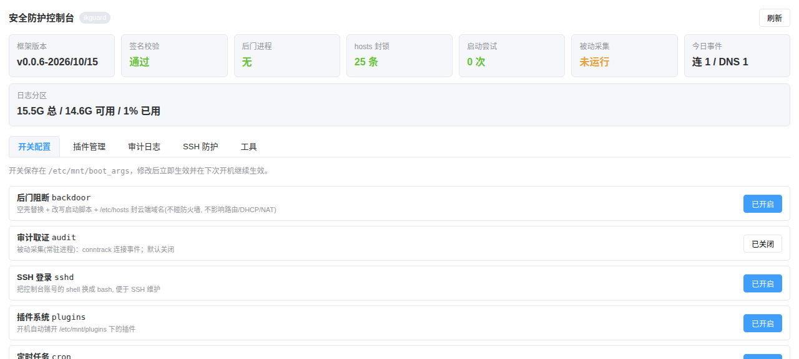
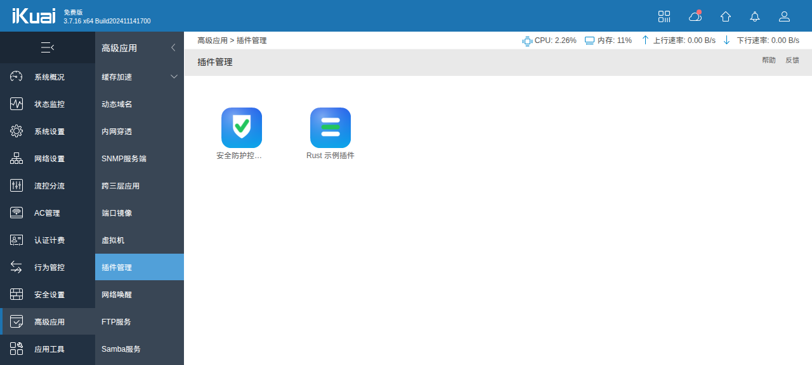
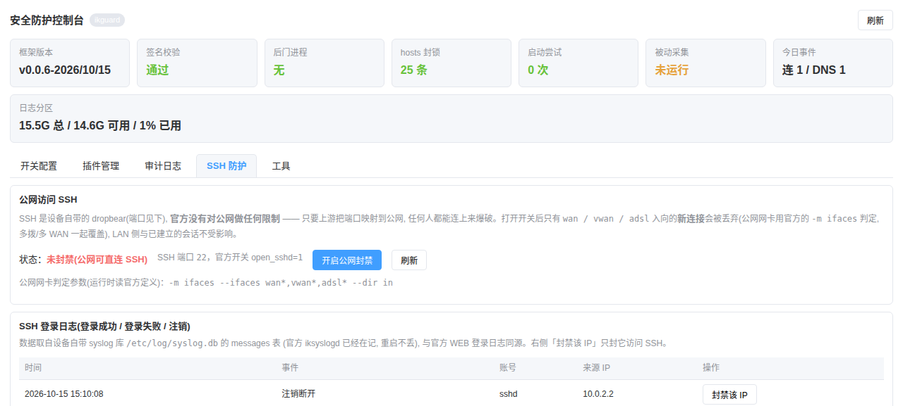
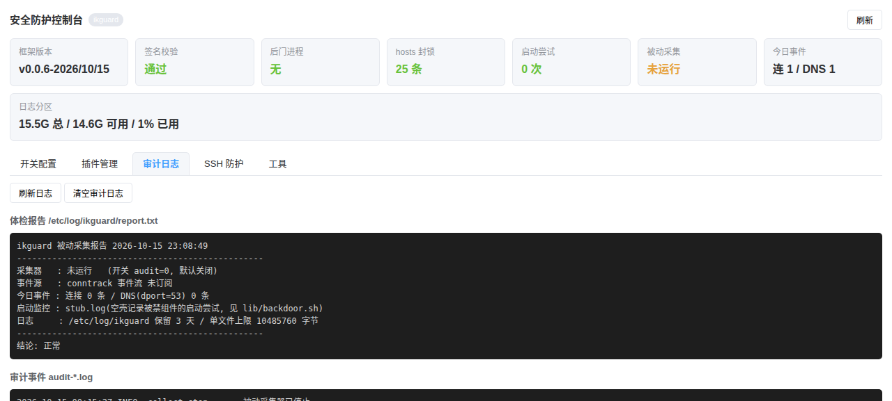

# iKuai 插件框架 (ikuai-plugins)

走官方**插件通道**（`firmwareid=90001`）给 iKuai 装上一个基础包，设备随即获得
**后门/更新通道阻断、插件系统、SSH 加固、审计取证、Web 控制台**。
不刷固件、不改分区表，卸载即恢复（基础包 = 一个签名的 `.bin` + 一个 `install.sh`）。

## 使用前必读（重要）

* **插件全部由 AI 生成，无法保证质量。** 本仓库的基础包与示例插件都是 AI 辅助写出来的，
  只做到"真机跑得通"这一级验证，**没有系统的代码评审与长期稳定性测试**。
  装之前建议**先让 AI 把要装的插件代码读一遍**，确认里面没有你不想要的行为
  （改系统文件、联网上报、常驻进程、改 DNS/防火墙等），再决定要不要装。
* **如无必要，不要装自己用不到的插件。** 插件以 root 运行，权限等同你自己在设备上敲命令；
  装得越多，出问题的面越大。不用了就在插件页删掉（`uninstall.sh` 会清理它加的东西）。
* **⚠️ 广告拦截插件 `ikadblock`（ADGUARD 类 DNS 拦截）可能存在问题和稳定性隐患，不建议使用。**
  它会接管 LAN 全网 DNS、并在设备上跑一个常驻 `ikdnsx` 实例；小内存设备上实例会被内核
  OOM kill。v0.0.9 虽然补了"拉起熔断 + fail-open"（撤规则而不是把 DNS 指到死端口），
  但拦截效果、规则库与长期稳定性都**没有验证充分**，请不要在生产网络启用。
* **向日葵插件 `awesun` 是目前验证最完整、推荐日常使用的插件**（见下节）。
* 遇到任何问题都欢迎提 [Issue](https://github.com/deadash/ikuai-plugins/issues)，
  尤其向日葵插件的问题会优先处理。

## 重点推荐：向日葵远程桌面插件（`awesun`）

把 iKuai 变成一台**手机就能远程操作**的机器：跑向日葵官方 Linux 端（`awesuncli`），
但画面与键鼠全部改走 X 服务器（`Xvfb` + `awescreen`）—— 不碰 `/dev/fb0`、
也不用内核 `uinput`（iKuai 内核没编）。原生编码与协议原样复用，用起来和普通向日葵被控端一样流畅。

* **不需要绑定爱快云**：插件完全独立，不依赖 iKuai 的云平台、不用开通任何服务；
  想把设备绑到向日葵账号下统一管理也可以，**绑不绑都能用**。
* 手机 App 或 `i.oray.com` 用识别码连接 → 选「桌面」，看到的就是 iKuai 后台网页
  （自动写入登录 cookie，密码不经过网络）；也可以开一块 shell 屏直接敲命令。
* 设备身份（识别码 / license / 访问密码）持久化在 `/etc/log/awesun/identity/`，
  重装插件、换固件都不变；登录一次向日葵账号后**免登录**（命令行版没有扫码登录）。
* 包体约 **212MB**（自带 `awesuncli` 与 X 组件），**必须用 v0.0.9 及以上的分片上传**才能在网页上装。
* 装法：Web「插件管理」上传 `awesun-v1.0.0-plugin.zip`；源码与详细说明见
  [ikuai-pro/plugins/awesun](https://github.com/deadash/ikuai-pro/tree/main/plugins/awesun)。
* **任何问题都可以提 [Issue](https://github.com/deadash/ikuai-plugins/issues)**，
  附上 `/etc/log/awesun/` 下的日志（`boot.log` / `web.log` / `desktop.log`）即可。

## 当前支持的功能

| 功能 | 开关 | 默认 | 说明 |
| --- | --- | --- | --- |
| **后门/更新通道阻断** | `backdoor` | 开 | ① 5 个云端客户端（`ik_rc_client`/`cre`/`pmd`/`dtalkd`/`dtalkc`）换成**空壳**；② 改写启动点：`rc`、`utils/monitor_process.sh`、`upgrade.sh`、`utils/collection.sh`、`dingtalk.sh`、`catcherd.sh`、`utils/submit.lua`、`utils/update_hosts.sh`、`ikaudit_update.sh`；③ 25 个云端域名写进 `/etc/hosts.d/ikblock` 片段指向 `0.0.0.0`；④ 空壳/被禁脚本被**任何**代码路径拉起时，往 `/etc/log/ikguard/stub.log` 记一行（时间 + 拉起者），据此发现枚举遗漏的新启动点。每次开机重应用 |
| **SSH 加固** | `sshguard` | 关 | ① 封禁 **WAN 侧新 SSH 连接**（公网网卡用官方 `-m ifaces` 判定、端口读官方 `sshd_port`、只拦 `--ctstate NEW` 所以不影响已建立的会话）；② **一键封禁来源 IP**（持久名单、开机重放，只挡它访问 SSH 端口，Web 不受影响）；③ Web 里看 **SSH 登录/失败/注销日志**（读官方 `/etc/log/syslog.db`，不另采）。命令行 `bin/sshguard` |
| **插件系统** | `plugins` | 开 | Web「高级应用 → 插件管理」出现卡片（**无需绑定爱快云**）；上传 zip 即安装；插件可放数据盘（存储位置绑定）；CLI `bin/ikplugin`（install/remove/scan/verify/pack/keygen） |
| **SSH 登录** | `sshd` | 开 | 把 `sshd` 账号的 shell 从控制台菜单换成 `/bin/bash`，可用 SSH 直接映射文件、改配置 |
| **审计取证** | `audit` | 关 | 常驻**被动采集**：conntrack 连接事件 / DNS 查询 / 封锁命中，日志落 `/etc/log/ikguard`。不占 cron |
| **cron / shell** | `cron` `shell` | 开 | `/etc/mnt/cron.d/*` → `/etc/crontabs/cron.d`；`/etc/mnt/shells` 下的程序与配置链接进系统 |
| **网页控制台** | 随 `plugins` | — | 状态概览（版本/验签/后门进程/hosts 条数/启动尝试/采集/日志分区）+ 开关配置 + 插件管理 + 审计日志 + **SSH 防护** + 工具（封锁自检、磁盘信息、原生日志与 DNS 开关） |
| **统一 UI 套件** | 随 `plugins` | — | 插件页共用的 Element Plus + Vue 套件（`www/ui/`，开机软链进 `.../plugins/app/ikui.{js,css}`），**插件包零依赖**：页面写 `./ikui.css` + `./ikui.js` 即可；控制台与示例插件页同一套视觉 |
| **/etc/mnt 扩容** | — | — | `bin/ikexpand`：官方升级包只给 50M，可按 G 扩容且保住数据盘、跨重启有效、可回滚 |
| **根分区腾空间** | — | — | 开机把固件里用不到的 qemu 大件（约 22MB）挪到插件存储再软链，否则根分区满到插件卡片连目录都建不出来；插件存储没挂就整体跳过 |
| **打包 / 自测** | — | — | `.tools/build.sh` 签名打包；`.tests/run_tests.sh` 离线测试（模拟真机布局）；`ikctl.py` 真机部署 + 一键体检 |

## 安装与升级

1. Web「**系统设置 → 系统升级**」上传 `ikuai-plugins-v0.0.9-base.bin`（已签名，`firmwareid=90001`）
2. 升级完成后**重启设备**（框架在开机时挂载：验签 → 清单比对 → 执行 `install.sh`）
3. 不想点网页时也可以用 `ikctl.py`：`deploy <bin>` → `reboot --wait` → `verify`

> **请用 v0.0.9 或更新**：0.0.9 起基础包自带插件框架与统一界面，插件页支持**大文件分片上传**
> （突破设备上传接口 50MB 的限制）与后台安装进度，插件管理也一起重做了。

## 开关（`/etc/mnt/boot_args`）

| 键 | 默认 | 作用 |
| --- | --- | --- |
| `ssh`/`sshd` | 1 | 控制台账号 shell 换 bash，可 SSH 登录 |
| `backdoor` | 1 | 后门/更新通道阻断（空壳 + 改写启动点 + hosts 封域名 + 启动监控） |
| `sshguard` | 0 | 封禁 WAN 侧新 SSH 连接（开了之后只剩 LAN 能连 SSH，Web 不受影响） |
| `plugins` | 1 | 插件系统（含 Web 插件资源同步；首次使用需在插件管理页同意《使用条款》） |
| `cron` | 1 | 铺开 `/etc/mnt/cron.d` |
| `shell` | 1 | 链接 `/etc/mnt/shells` 下的程序/配置 |
| `audit` | 0 | 审计取证（=1 才运行被动采集器） |

> 升级时会自动从 `boot_args` 清掉历史遗留的空开关：`remote`、`plugins_verify`、
> `backdoor_hosts`、`probe`。**框架自己不写任何定时任务**。

## 目录

| 路径 | 持久 | 内容 |
| --- | --- | --- |
| `/etc/mnt/.boot` | ✔ | 框架本体（`install.sh` + `scripts/ lib/ bin/ usr/ www/`） |
| `/etc/mnt/plugins` | ✔ | 插件包与安装目录（可绑定到数据盘） |
| `/etc/mnt/ikguard` | ✔ | SSH 封禁名单等运行状态 |
| `/etc/log/ikguard` | ✔ | 日志：`boot.log`、`audit-*.log`、`stub.log`（启动尝试）、`report.txt` |
| `/usr/ikuai/www/plugins`、`/usr/ikuai/function/ikguard`、`/usr/sbin/ikaudit` 等 | ✘ | 开机重建的软链与页面（根分区每次重启还原） |

## 随版发布的插件

基础包**不含插件**：插件是独立 zip，在 Web「高级应用 → 插件管理」上传安装（插件包不需要签名）。

| 插件 | 版本 | 作用 |
| --- | --- | --- |
| [awesun](https://github.com/deadash/ikuai-pro/tree/main/plugins/awesun) | 1.0.0 | **向日葵远程桌面（重点推荐）**：官方 `awesuncli` + X11 虚拟桌面，手机 App 直接操作 iKuai 后台；约 212MB，需 v0.0.9 的分片上传 |
| [ikupd](examples/ikupd-plugin/) | 1.0.0 | **插件在线升级**：从仓库 Release 检查新版（按包名前缀 + sha256 判断），支持代理拉取，确认后下载安装 |
| [ikadblock](examples/adblock-plugin/) | 1.0.0 | ⚠️ **广告/跟踪域名拦截（ADGUARD 类）**：LAN 全网 DNS 纳管到本机 sinkhole，命中黑名单返回 `0.0.0.0`。**可能有问题，不建议使用**（见"使用前必读"） |
| [bnfix](examples/bnfix-plugin/) | 1.0.0 | **系统 OpenSSL 组件修复**：给自带 `libcrypto` 打 1 字节定点补丁，修"显式曲线参数 + 压缩点"证书解析死循环 |
| [rustdemo](examples/rust-plugin/) | 1.0.0 | **Rust 示例插件**：编译型插件的完整示例（嵌入式数据库 + Web 配置页） |

> 推荐顺序：**先装基础包，再按需装 `ikupd`（在线升级）与 `awesun`（远程桌面）**；
> 另外三个示例插件属于"可以看、可以学"，不是非装不可 —— 装了就用 AI 先把代码过一遍。
>
> **v0.0.7 起**：插件页面的 UI 套件改由基础包提供（`www/ui/` → 开机软链到 `.../plugins/app/ikui.*`），
> 所以上面四个示例插件的 `1.0.0` 包已随本版重打。**先升基础包再换插件**，否则新插件页会加载不到 `ikui.js`。

### v0.0.9 起：自带插件框架 / 大文件上传 / 插件管理

* **基础包自带整套插件框架**：插件包只要 `Release` + `install.sh`/`boot.sh`/`uninstall.sh`
  + `bin/` + `function/` + `www/`，**不用自带 UI 库**（以前每个插件白背约 1.6MB）。
* **界面统一**：套件 `www/ui/ikui.{js,css}`（Element Plus 2.14 + Vue 3 + 设计令牌）由基础包提供，
  插件页写 `./ikui.css` + `./ikui.js` 就能用 `<ik-tile>` 指标卡、`ik-toolbar` 工具栏、
  `ik-pre` 日志块与 `IKUI.mount` / `IKUI.toast`。**后续让 AI 生成插件，请直接沿用这套界面与交互**
  —— 页面模板要放 `<script type="text/x-template">`，否则自闭合组件标签会被 HTML 解析器吞掉。
* **大文件上传（原来只支持 50MB）**：设备原生 `/Action/upload` 单文件只收 **50MB**，而且每次
  上传成功都会清空导入目录。0.0.9 起页面按 **32MB 分片**上传（每片落盘后立刻 `stage` 到暂存区，
  最后按序号合并并核对字节数），安装转后台执行、`show TYPE=iplog` 实时回传进度与日志 ——
  **200MB+ 的包（如向日葵）也能在网页上直接传**，不会再 60 秒超时。
* **插件管理重做**：上传与安装合成一条进度条（分片数 / 速率 / 耗时）+ 实时安装日志，
  装完自动刷新列表，失败能看到 `rc` 与后台日志尾部。

## 开发

* **打包签名**：`.tools/build.sh`（产物在 `.dist/custom.bin`）。清单必须与实际铺开的文件**完全一致**，
  否则设备端挂载会被拒绝；README 与 `docs/` 都在基础包内，改完要重新签名打包。
* **离线测试**：`bash .tests/run_tests.sh`（mock 真机布局 + iptables/ipset/killall 替身）。
* **真机**：`python3 ikctl.py deploy|reboot|verify|sh|push|pull`（`verify` 一键体检）。
* **写插件**：用仓库内技能 [`.codebuddy/skills/ikuai-plugin-dev/`](.codebuddy/skills/ikuai-plugin-dev/SKILL.md)
  —— 附带已在真机验证过的模板插件与脚手架/部署脚本，不必从源码反推。
* **交叉编译**：参考 [ikuai-sdk](https://github.com/deadash/ikuai-sdk)。

## 边界与说明

* 阻断**只封域名**（`/etc/hosts` 片段），不封 IP/网段/端口、不碰官方防火墙链；
  唯一会写 iptables 的是你显式开启的 `sshguard`，规则落在自建链上、默认关闭时一条都不写。
* **不写 cron、无常驻进程**（除 `audit=1` 的被动采集器）；常驻进程都是插件自己起的
  （如 `awesun` 的 Xvfb/awescreen、`ikadblock` 的 `ikdnsx`），不用就删插件。
* **本框架与爱快官方无关**，插件由 AI 生成、质量与安全性需自行评估 —— 有疑虑就让 AI
  先读代码，见 [使用前必读](#使用前必读重要)。
* 根分区每次重启还原，所以规则/软链/补丁都在**开机重放**；持久状态只在 `/etc/mnt` 与 `/etc/log`。
* 完整操作手册（分区与扩容、打包签名约束、SSH 升级、重启验证、审计、Web 插件、
  真实 WAN/LAN 客户端模拟、排障）见 [docs/OPERATIONS.md](docs/OPERATIONS.md)。
