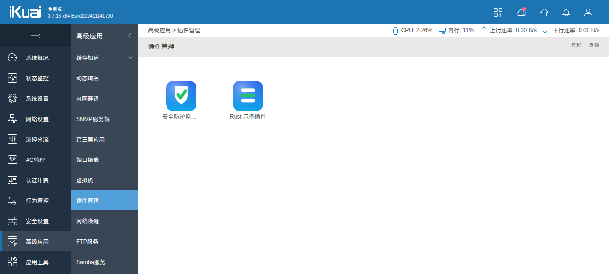
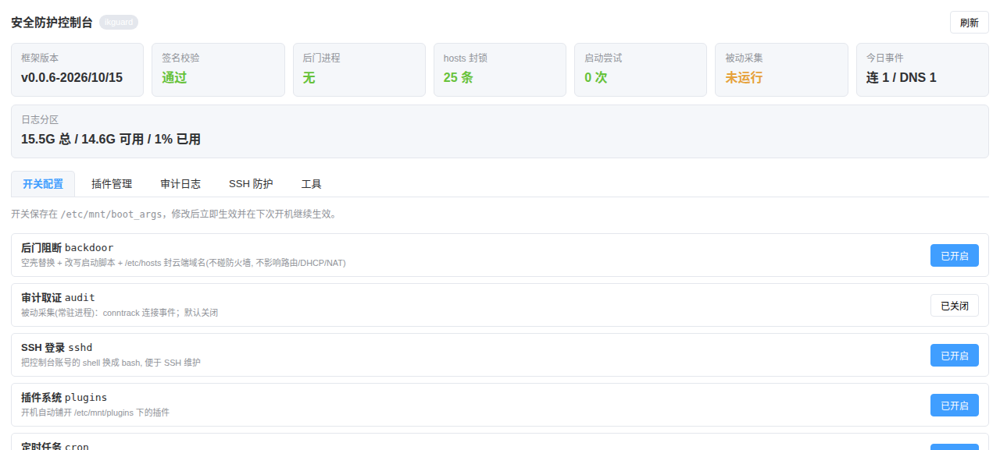

# 写插件请先用技能

> **推荐: 用 [`.codebuddy/skills/ikuai-plugin-dev/`](.codebuddy/skills/ikuai-plugin-dev/SKILL.md) 技能来生成插件。**
>
> 它是本仓库内置的 **iKuai 插件开发技能**, 已经把"每次都要重新读源码才能搞清楚"的东西整理成参考资料:
> **插件包格式 / 安装-开机-卸载生命周期 / Web 卡片-页面-后端接口 / 开机自启与常驻进程 /
> sqlite3(设备 3.8.11.1 的语法边界) / LuaJIT(cjson、lsqlite3) 调用 / uClibc SDK 与 Rust 编译 /
> 真机 SSH 安装-卸载-重启验证流程**。
>
> 附带一个**已在真机完整验证过的模板插件**(`assets/template/`)、脚手架脚本 `scripts/new-plugin.sh`
> 与部署脚本 `scripts/deploy-plugin.sh` —— 用 CodeBuddy 打开本仓库后直接说
> "用 ikuai-plugin-dev 技能做一个 XXX 插件"(或让它加载该技能)即可, 不必再从 `lib/plugin.sh` 反推。
>
> 该技能只覆盖**插件包**(基础包/签名不在其范围)。技能目录是点目录, 打包与签名会自动排除, 不影响基础包。

# sdk

如果需要自己编译程序，参考 [ikuai-sdk](https://github.com/deadash/ikuai-sdk)

# 支持以下功能

1. 支持ssh直接打开, 便于映射文件和修改
2. 支持cron, 可以定时任务
3. 支持shells, 可以拷贝程序和配置
4. **后门禁用**: 阻断/删除爱快云端后门与更新通道(不影响路由等本地功能)
5. **插件系统**: 上传一个 zip 包即可安装插件(参考官方 firmwareid=90001 方案)
6. **审计取证**: 记录进程启动、DNS 请求、网络连接、封锁命中, 用于确认没有后门进程/连接
7. **网页插件**: 在 Web「系统设置 → 插件管理」里出现卡片, 可查看状态并配置开关

> 日志统一落在持久分区 `/etc/log/ikguard/`(根分区每次重启还原且只有 ~800K 可用)。
> 完整操作手册(分区/打包签名/SSH 升级/重启验证/审计/Web 插件/真实 WAN 与 LAN 客户端模拟)见 [docs/OPERATIONS.md](docs/OPERATIONS.md)。

# 配置如下

在路径 `/etc/mnt/boot_args` 是配置参数, 等于1是打开，等于0则是关闭

比如关闭ssh，则可以执行 `sed -i "s/^sshd=.*/sshd=0/" /etc/mnt/boot_args`

打开则相反，`sed -i "s/^sshd=.*/sshd=1/" /etc/mnt/boot_args`

各配置名称如下

1. ssh, sshd
2. 后门禁用, backdoor (默认开启)
3. 后门DNS屏蔽, backdoor_hosts (默认关闭, 写 /etc/hosts 屏蔽云端域名)
4. 插件, plugins (默认开启, 首次使用需在插件管理页同意《使用条款》)
5. cron, cron, cron_test
6. 程序安装, shell
7. 审计取证, audit (默认关闭; 开启后运行常驻**被动采集**进程, 不占 cron, 日志写 /etc/log/ikguard)
8. 定时自检, probe (默认关闭, 开启后把云端连通性自检写入定时任务, 重启仍生效)

> 两个曾经存在的开关已经去掉:
> `remote`(历史遗留的空开关, iKuai 云的"远程控制/远程维护"已由 backdoor 层覆盖)、
> `plugins_verify`(插件强校验, 现在插件包不再要求签名)。升级时会自动从 boot_args 里清掉。

## 配置 cron

在 `/etc/mnt/cron.d` 下新建一个文件，里面写入crontab语句即可重启后生效

如果需要测试cron功能，可以打开 `cron_test=1` 到 `/etc/mnt/boot_args`

然后查看日志 `tail -f /var/log/crond.log`

其中, 如果想动态测试，则修改 `/etc/crontabs/root` 文件

## 配置 shells

在 `/etc/mnt/shells/bin` 下放应用程序和相关的sh脚本，这些文件会动态链接到 `/usr/sbin` 下，注意，重启后生效，如果测试，请手动链接

在 `/etc/mnt/shells/etc` 下放配置文件，这些文件会动态链接到 `/usr/local/etc` 下，也是重启生效，测试可以手动链接

## 后门禁用 (backdoor)

`scripts/02_disable_backdoor.sh` 每次开机执行 `lib/backdoor.sh`，三层阻断:

1. **进程层**: 杀灭并用空壳替换 `ik_rc_client` / `cre` / `cre_client` / `pmd` /
   `dtalkd` / `dtalkc` / `catcherd`，删除云端地址表软链接
2. **文件层**: 改写宿主脚本，使其不再被拉起:
   - `usr/ikuai/script/rc`: 注释 `ik_rc_client` / `pmd` / `cre` / `cre_client` 启动项、
     不再启动 `submit.lua`(云端指令通道) 与 `update_hosts.sh`(云端取址)
   - `usr/ikuai/script/utils/monitor_process.sh`: 不再守护上述进程
   - `usr/ikuai/script/utils/collection.sh`: 跳过远控连通性判断(否则 24h 后自关多线IPv6)
   - `usr/ikuai/script/dingtalk.sh` + `usr/DTalkInside/monidtalk.sh`: 停用 dtalk 云管
   - `usr/ikuai/script/catcherd.sh`: 停用抓包上报
   - `usr/ikuai/script/utils/submit.lua` / `usr/ikuai/script/upgrade.sh`: 禁用云端指令与自动升级
3. **网络层**: `ipset ikuai_blk` + `iptables OUTPUT/FORWARD` 封锁全部爱快云端域名/IP
   与云端专用端口(1853/2016/2221/2502/6000/9443/15602/1863/32015/32017/8086/6444/21422)

由于根分区每次重启还原，`scripts/02` 会安装一个每分钟的 cron 守卫
(`/etc/crontabs/cron.d/ikblock_guard` -> `bin/backdoor_guard`)，在系统重建 iptables
后自动补回封锁、并再次清理被拉起的后门进程。

可选的额外域名/IP 可通过 `/etc/mnt/ikblock.domains`、`/etc/mnt/ikblock.nets`
(一行一条) 追加。

> 说明: 保留 `plugins.sh` 钩子是必需的——它是本框架的启动入口（本地校验，不联网）。
> 云端驱动的升级通道已全部切断；本地手动上传固件/插件的能力按需保留。

## 插件系统 (plugins)

目录(位于持久盘，重启不丢):

```
/etc/mnt/plugins/                插件根目录
/etc/mnt/plugins/*.zip           待安装插件包(开机自动安装)
/etc/mnt/plugins/<name>/         已安装插件本体
/etc/mnt/plugins/.installed/     已安装 zip 归档
/etc/mnt/.boot/plugin.pub        插件校验公钥(可选)
/etc/mnt/plugins/plugin.key      打包签名私钥(可选)
```

**安装**: 把 `xxx.zip` 传到 `/etc/mnt/plugins/` 后执行 `ikplugin scan`，或直接重启
(开机会自动安装)。

**插件包(zip)格式**:

```
Release           必需  plugin=<名称>  version=<版本>
install.sh        必需  安装/每次开机执行(需幂等)
boot.sh           可选  仅每次开机执行(优先于 install.sh)
uninstall.sh      可选  卸载
MANIFEST.MF       可选  Name: / SHA-256-Digest: 摘要清单
SIGNATURE.RSA     可选  openssl dgst -sha256 -sign 结果
bin/*             可选  自动软链到 /usr/sbin (去掉 .sh 后缀)
etc/*             可选  自动软链到 /usr/local/etc
```

脚本执行时会带上环境变量: `PLUGIN_NAME` `PLUGIN_VERSION` `PLUGIN_DIR`
`PLUGIN_ROOT` `PLUGIN_ACTION`(install/boot/uninstall) `IK_SYSROOT`。

**命令行**:

```
ikplugin list                 列出已安装插件
ikplugin install <zip|目录>    安装插件
ikplugin remove <名称>         卸载插件
ikplugin scan                 扫描 /etc/mnt/plugins/*.zip 并安装
ikplugin verify <zip|目录>     仅校验插件包
ikplugin pack <目录> <zip>     打包(自动生成清单并签名)
ikplugin keygen [目录]         生成签名密钥对
```

**签名(可选)**: 插件包**不强制要求签名**，普通 zip(含 `Release` + `install.sh`)即可安装。
如果插件包自带 `MANIFEST.MF`，会逐文件校验 SHA-256；再带 `SIGNATURE.RSA` 且存在
`/etc/mnt/.boot/plugin.pub` 时才会额外校验签名。打包签名用 `ikplugin keygen` + `ikplugin pack`。

> 注意区分: **框架本体 `/etc/mnt/.boot` 是必须签名的**(固件开机会校验，不通过整个框架不运行)，
> 只有第三方插件包不要求签名。

**插件包还能带 Web 页面与后端接口**(会自动软链到根分区，卸载自动清理):

```
www/plugins/<名称>/<名称>.json   插件卡片     -> /usr/ikuai/www/plugins/<名称>/
www/plugins/app/<名称>.html|png  页面与图标   -> /usr/ikuai/www/plugins/app/
function/<func_name>             后端接口     -> /usr/ikuai/function/
bin/*                            命令行      -> /usr/sbin/
```

完整可运行示例：

* [examples/rust-plugin](examples/rust-plugin/) —— Rust + 嵌入式数据库 + Web 配置页。
  编译方式有两种(见该示例的 README)：**musl 静态**(仓库默认，实测 945KB/整包 454KB)与
  **iKuai SDK 的 uClibc 交叉编译**(动态链接设备自带 libc，体积更小)。
* [examples/bnfix-plugin](examples/bnfix-plugin/) —— 纯 shell 的最小示例（整包约 15KB，
  **不编译任何东西**）：演示"就地给系统共享库打 1 字节定点补丁 + 每次开机重新施加 + 自检"，
  以及"卸载后重启即彻底失效"的做法。
* [examples/adblock-plugin](examples/adblock-plugin/) —— 广告/跟踪域名拦截（整包 27KB，**不编译任何东西**）：
  用设备自带的 `ikdnsx` 跑一个独立 sinkhole 实例 + iptables `REDIRECT` 把 LAN 侧 UDP/53 纳管，
  命中黑名单返回 `0.0.0.0`；演示"常驻实例 + 定时守卫 + fail-open 撤规则"的自启/自愈写法，
  以及"内置种子表离线可用 + 一键拉取 anti-AD / StevenBlack 开源规则库"。

**安装方式**:
1. 网页: 系统设置 → 插件管理 → ikguard → 插件管理 → 选择 zip → 上传并安装
2. 命令行: 把 zip 放到 `/etc/mnt/plugins/` 后执行 `ikplugin scan`(或直接重启)
3. 命令行: `ikplugin install /path/xxx.zip`

## 审计取证 (audit) —— 被动采集，不用 cron

`audit=1` 时由 `scripts/06_enable_audit.sh` 拉起一个**常驻被动采集进程**(`ikaudit collect`)，
事件全部由内核推送，**没有任何定时轮询**：

| 事件源 | 拿到什么 |
| --- | --- |
| `conntrack -E` | 连接事件(`[NEW]`/`[DESTROY]`)；其中 `dport=53` 的另存为 DNS 事件 |
| `/dev/kmsg` | **封锁命中**：命中封锁链的包由 `-j LOG` 写进内核日志，采集器读出来 |

不做的事（设计上明确移除）：

* **不判断"程序启动"** —— 本内核没编 `CONFIG_CONNECTOR`(cn_proc)/`CONFIG_AUDIT`/`CONFIG_KPROBES`/`CONFIG_FTRACE`，没有 exec/fork 事件源。
* **不抓包做 DNS** —— DNS 只是连接事件里 `dport=53` 的子集；conntrack 不含报文，所以只能到"谁向谁查"，**拿不到域名**。
* **封锁命中不读计数器** —— DROP 掉的包不会进 conntrack，只能靠 `-j LOG` 事件。

设备的 `iptables` 自带 `-j LOG`（实测 3.7.16：`iptables -j LOG -h` 直接列出 `--log-prefix`，
加规则后内核日志确实出现命中记录），所以框架**不分发任何额外构件**；万一某固件砍掉了它，
可用 `.tools/build_xt_LOG.sh` 编一个补上。

日志写在持久分区 `/etc/log/ikguard/`（时间 + 体积双限：保留 3 天、目录 300MB、单文件 10MB）：

| 文件 | 内容 |
| --- | --- |
| `boot.log` | 框架开机日志 |
| `audit-YYYYMMDD.log` | 结构化事件: `collect.begin/stop` `block.hit` `cloud.leak` `probe.*` … |
| `conn-YYYYMMDD.log` | 连接事件(公网方向) |
| `dns-YYYYMMDD.log` | DNS 事件(`dport=53`) |
| `block-YYYYMMDD.log` | 封锁命中原始记录 |
| `report.txt` | 最近一次采集报告 |

```
ikaudit status          # 采集器/事件源/日志/封锁状态
ikaudit tail 80         # 最近的审计事件
ikaudit collect-start   # 后台启动被动采集器(也可用控制台开关)
ikaudit collect-stop    # 停止采集器(按 pid 关闭并清 LOG 规则)
ikaudit collect-status  # 采集器是否在运行
ikaudit report          # 立刻生成报告(异常返回码 1)
ikaudit probe           # 云端连通性自检(解析 + TCP 443 尝试；立即执行一次)
ikaudit cronsync        # 重建定时任务(只有 probe=1 才写自检 cron)
```

> **采集不占 cron**：`audit` 是持久化开关，=1 时开机自动拉起采集器、=0 时停掉并清掉框架的定时任务；
> 控制台开关即时生效，重启按配置恢复。
> **定时自检(`probe`)仍走 cron**：默认关闭，开启后才写 `*/10 ikaudit probe`，重启按配置重建。

## 网页插件 (Web)



> 「高级应用 → 插件管理」里的插件卡片(实拍: iKuai 3.7.16 x64 + 本框架 v0.0.4)。
> `安全防护控制台` 是基础包内置的 ikguard 插件；`Rust 示例插件` 是通过插件管理**单独上传安装**的
> `rustdemo.zip` —— **基础包与插件是两个独立发布物**, 基础包里不含任何插件。
> 目前随版发布的独立插件有三个：`rustdemo-v1.0.0-plugin.zip`(示例)、
> `bnfix-v1.0.0-plugin.zip`(系统 OpenSSL 组件修复) 与 `ikadblock-v1.0.0-plugin.zip`(广告/跟踪域名拦截)。



> 点开卡片就是插件自己的页面: 概览(框架版本 / 签名校验 / 后门进程 / ipset 封锁 / 封锁规则 /
> 封锁命中 / DNS 记录 / 日志分区) + 开关配置(后门阻断、后门 DNS 屏蔽、审计取证、SSH 登录…),
> 改完立即生效并写入 `/etc/mnt/boot_args`。

iKuai 的「系统设置 → 插件管理」是数据驱动的: 官方 `plugins.sh` 的 `show()` 会遍历
`/usr/ikuai/www/plugins/*/*.json` 生成卡片，卡片点击后以 iframe 打开
`/plugins/<目录>/<name>.html`(原目录名是 `docker`，本框架改成了 `app`)。本框架在 `www/` 下
提供资源，开机由 `scripts/03_enable_plugins.sh` 同步到根分区:

```
www/plugins/<name>/<name>.json   元数据(name 决定卡片与 iframe 文件名)
www/plugins/app/<name>.html      插件页面(自包含, 直接 fetch /Action/call)
www/plugins/app/<name>.png       卡片图标
www/eula.txt                     《使用条款与免责声明》正文(后端接口读取)
usr/ikuai/function/<func_name>   后端接口(#!/bin/bash /etc/ikcommon)
```

内置插件 `ikguard`: 概览(签名/后门进程/封锁规则/命中数/DNS 状态/日志占用)、
开关配置(写 `/etc/mnt/boot_args` 并立即生效)、插件管理(**上传 zip 安装**/扫描/卸载)、
审计日志(实时查看)、工具(云端连通性自检、DNS 记录开关，均带用途说明)。

**首次启用需要同意《使用条款》**: 未同意时插件功能不启用 —— 插件管理页只显示一个灰色按钮
"查看并同意《使用条款》"，点开弹框阅读后同意才出现插件；同意记录写在
`/etc/mnt/plugins/.eula`(持久，只在本机保存)，后端 `ikguard` 的 `plugin` 动作也会拒绝未同意的调用。
条款正文在 `www/eula.txt`(版本 v1.0)。

**前端补丁**(`lib/plugin.sh:plugin_web_patch()`，每次开机重打):
1. 去掉"使用插件功能需要绑定爱快云平台！"拦截
   (`yunbindstatus = ("" != code ? 2 : 1)` → `yunbindstatus=2`)；
2. 插件页面目录 `/plugins/docker/` → `/plugins/app/`，不再和 Docker 功能混在一起；
3. 点开插件后的小标题 `Docker` → `插件`；
4. 顶部"爱快e云APP 掌上办，更方便"云绑定二维码弹框不再弹出
   (`.tipCloudBind=!0` → `.tipCloudBind=!1`)；
5. 插件卡片显示元数据里的 `title`(中文名) 而不是文件名
   (`_s(e.name)` → `_s(e.title||e.name)`，`title` 写在 `www/plugins/<名>/<名>.json` 里)。
   分包是 gzip 静态资源，做法是"解开 → sed → 重新压缩 → 复核后写回"，改完需 **Ctrl+F5 强刷**。

接口约定: `POST /Action/call` `{func_name, action, param}`, 动作 `show` 的动作函数
输出被包成 `{"Result":30000,"Data":{...}}`; 参数值不允许含空格/引号。

## 本地离线测试

不接触真机，在 Linux / Git-Bash 下运行:

```
bash .tests/run_tests.sh
```

它会在 `.tests/.mock` 生成一个"模拟系统根目录"(含 rc / monitor_process.sh /
collection.sh 等目标文件片段)，部署框架并执行开机引导，然后断言后门是否被正确阻断、
插件系统是否可用。所有会改动系统的命令(iptables/ipset/killall/pidof 等)在测试中
都用 `.tests/shims/` 下的替身记录，不会影响本机。

## 重要: 修改后必须重新签名

官方 `/usr/ikuai/script/plugins.sh` 会用内置公钥校验 `/etc/mnt/.boot/{MANIFEST.MF,SIGNATURE.RSA}`，
并且逐文件校验清单里的 SHA-256。**改动 `.boot` 内任何被清单列出的文件后，都必须重新签名**，
否则开机校验失败，整个框架不会运行。

```
bash .tools/sign.sh     # 用 .tools/private.pem 生成 MANIFEST.MF + SIGNATURE.RSA
bash .tools/verify.sh   # 本地自检
bash .tools/build.sh    # 打出 .dist/custom.bin(firmwareid=90001)
```

> 注意: 打包前必须把文件统一成 LF 换行(Windows 上很容易带 CRLF，会让设备上的
> `install.sh`/`*.sh` 直接语法报错)，且 `.tools/private.pem` 要与固件内置公钥配对。
> 详细流程见 [docs/OPERATIONS.md](docs/OPERATIONS.md)。
